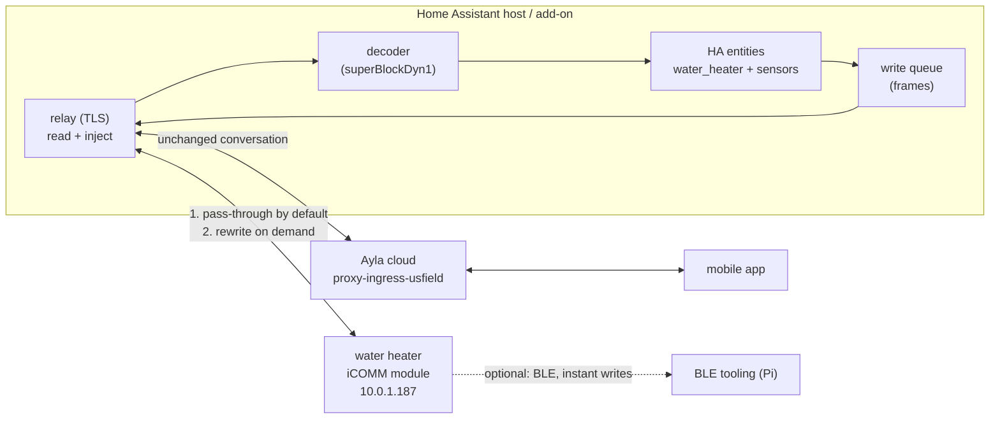

# Building blocks for a local A.O. Smith heat-pump integration

What this is: the map, not the product. Every block below is either **proven** on
this appliance (with the measurement that proves it), **prototype** (it works in
`mitm/` but was not built for production), or **unknown** (an open question that
decides a design choice). Nothing here should be built until the unknowns that
matter are closed.

The goal, in the owner's words: a clean, user-friendly, local-only Home Assistant
plugin that controls the water heater, *while* the mobile app and other cloud
features keep working — and that survives Ayla being down, slow, or lossy, which it
often is.

## The shape this has to take

Not "replace the cloud with a local server". That breaks the app instantly: an
earlier local-answering prototype made Home Assistant report the device
`unavailable` for the whole session because Ayla stopped seeing it.

What works is a **transparent relay**: sit in the path of the module's cloud
traffic, forward everything upstream by default, and only rewrite a response when
there is a reason to. Measured: with the relay forwarding, Home Assistant kept
showing `heat_pump` with a live setpoint for the entire armed session, and a cloud
write issued mid-session was accepted. With a local-answer rule instead, the device
vanished from Ayla.

## Blocks

| # | Block | Status | Evidence / notes |
|---|---|---|---|
| 1 | **Path steering** | prototype | One DNS override for `proxy-ingress-usfield.aylanetworks.com` beats DNAT. ARP wedges this module. DNAT works but needs gateway rights and a conntrack flush. |
| 2 | **Existing-connection handling** | proven | DNAT only steers *new* connections; the module holds one open. `conntrack -D -s <module> -p tcp --dport 443` forces a re-dial. Without it: six armed minutes, zero requests. |
| 3 | **TLS termination** | proven | The module accepts **any** RSA-2048/SHA-256 leaf named `*.aylanetworks.com`; it never validates the chain. A self-signed cert is enough. A P-384/ECDSA leaf deadlocks the handshake silently for 30 s — the trap. |
| 4 | **Relay / forward-with-overrides** | prototype | Pass-through by default; `inject`, `hold`, `close`, `each`, `echo_headers` and local-answer rules exist in `mitm/ayla-mitm.py`. Only `inject` preserves the cloud view. |
| 5 | **Telemetry decode** | proven | Five blocks in `superBlockDyn1` are documented field by field in `icomm/README.md`. Read path is effectively solved. |
| 6 | **Command codec** | proven | `BD 40 <len> <block> <offset> <value> <crc8>`; `mitm/frame.py` regenerates the frames Ayla actually sent, byte for byte. |
| 7 | **Write path A — cloud poll injection** | proven for setpoint | Serve a frame as the reply to `commands.xml`. 125 °F and 148 °F were applied and confirmed from telemetry. Latency = time to next poll: **minutes**, and polls are rare. |
| 8 | **Write path B — BLE** | prototype, unproven here | `ble/` already writes registers directly and is instant. Pairing is the friction. This is the only known route to sub-second writes. |
| 9 | **Write path C — through Ayla** | proven, fragile | What Home Assistant's `aosmith` integration does. Correct semantics, but fails when Ayla is slow: a service call hung for 90 s tonight. |
| 10 | **Mode control** | **unknown** | `ble/README.md` documents MODE as block 26 offset 0 (`ELECTRIC=32`, `HYBRID=16`, `EFFICIENCY=8`). Whether the *cloud* channel honours 26/0 is untested — delivery never happened, for lack of a poll. |
| 11 | **State readout for HA** | prototype | `mitm/summarise.py` prints it; turning it into MQTT or HA state is straightforward. |
| 12 | **Resilience** | **not built** | The owner's explicit requirement. See below — this is the block with real design work in it. |
| 13 | **Observability** | prototype | JSONL flow log, TLS-window decoder, summariser, all in `mitm/`. Cheap to keep, valuable when debugging a flaky cloud. |
| 14 | **Packaging** | not started | HA add-on: one container, config for device id and cert, DNS override documented. |

## Resilience, since Ayla is unreliable

The failure mode to avoid is the one seen tonight: **the device backs off for
minutes when its cloud connection misbehaves, and nothing wakes it early.** Blocking
its ops channel did not wake it; hanging up did not; a cloud write did not when it
was idle. Backoff is expensive, so the relay must never hand the device a failure it
could have absorbed.

Proposed behaviour, per request:

1. **Upstream budget.** Forward with a short timeout (tens of seconds, measured to
   be enough — Ayla answers in ~100 ms when healthy). Never let the device sit on an
   open request the way Home Assistant's integration did for 90 s.
2. **Degrade locally on failure.** On timeout or 5xx: answer telemetry POSTs with a
   synthetic `200` and stash the payload, and answer polls with an empty
   `<commands/>` (or a queued command of ours). The device sees a healthy cloud.
3. **Circuit breaker.** After N consecutive failures, stop waiting on upstream
   entirely for a cooldown, with a cheap health probe in the background. This keeps
   local reads and local writes working *while Ayla is down*, which is the whole
   point of being local.
4. **Buffer, then decide.** Telemetry collected while degraded is journaled locally.
   On recovery either replay it (Ayla timestamps it at POST time, so history shifts)
   or keep it local-only. That is a product decision, not a technical one, and it
   should be configurable.
5. **Idempotent commands.** A queued frame must be delivered exactly once, and must
   survive a reconnect. Frames are consumed from a file today; that needs a real
   queue with an acknowledgement from the device's own telemetry.
6. **Recovery is passive.** The module re-dials on its own; the relay does not need
   to poke it. Verify by watching for the next telemetry, not by forcing a dial.

Two open questions that shape this block: whether Ayla treats the device as offline
when polls stop reaching it (strongly implied — HA showed `unavailable` in
local-answer mode), and whether the module's backoff can be shortened at all.

## Measured tonight, which sharpens two blocks

* **Ayla's own write path can hang indefinitely.** Home Assistant's
  `set_temperature` returned nothing after 40–90 s, three times, while reads on the
  same integration answered in 19 ms — and a full HA core restart did not fix it.
  That is the integration blocked on an Ayla call that never returns. A local plugin
  that delegates writes to the cloud inherits exactly this failure, which is the
  strongest argument for owning the write path locally.
* **The module goes quiet for far longer than any timeout.** Twenty minutes with the
  relay armed, no writes, idle tank: zero HTTPS requests. Later, while its compressor
  was running, still zero. Its own backoff, after every connection we broke today,
  is measured in many minutes, and nothing short of time cleared it. So a local write
  path must tolerate "the device will collect this when it feels like it", which means
  a durable queue rather than a request that can fail.

## What must be true before building

* **Mode write over the cloud**: does block 26 offset 0 work through
  `setBlockParameter`, or does the cloud map differ from the BLE map the way the
  setpoint does (11/6 rather than 13/2)? Until this is answered, mode control is
  BLE-only.
* **Poll cadence**: what makes the module poll? Today: mostly nothing. A poll is
  what delivers a queued command, so write latency depends on this. If it cannot be
  influenced, path A is best-effort and path B (BLE) is the real control channel.
* **The `0%` availability field**: not located. `block[3]` carries `100`s that are
  physical tank fullness, not hot-water availability. A read-only plugin would ship
  without it.
* **Power**: not measured. `block[4]` 12–13 is the element's 4500 W when energised
  and `block[1]` 99 is line volts; `4500 × (V/240)²` reproduces the app's 4315 W to
  within a watt, but that is a calculation, not a reading.

## Suggested phasing (when the unknowns are closed)

1. **Read-only relay** — path steering, TLS, pass-through, decode, HA sensors. Zero
   risk to the appliance, immediate value, and it exercises blocks 1–6 and 11.
2. **Resilience** — budget, degrade, circuit breaker, journal. Do it before writes,
   because a failed write during a cloud outage is what loses trust.
3. **Writes** — BLE first for latency, cloud injection second for reach. Both
   behind one queue with confirmation from telemetry.
4. **Mode**, once block 10 is answered.
5. **Packaging** — add-on, config, and a first-run check that the module actually
   dialed through us.
