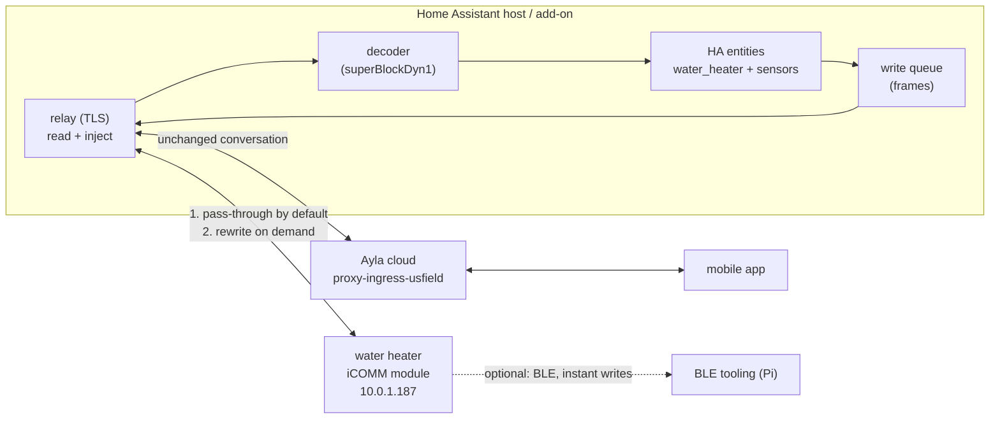

# Building blocks for a local A.O. Smith heat-pump integration

What this is: the map, not the product. Every block below is either **proven** on
this appliance (with the measurement that proves it), **prototype** (it works in
`mitm/` but was not built for production), or **unknown** (an open question that
decides a design choice). Nothing here should be built until the unknowns that
matter are closed.

The goal, in the owner's words: a clean, user-friendly, local-only Home Assistant
plugin that controls the water heater, *while* the mobile app and other cloud
features keep working — and that survives Ayla being down, slow, or lossy, which it
often is.

## The shape this has to take

Not "replace the cloud with a local server". That breaks the app instantly: an
earlier local-answering prototype made Home Assistant report the device
`unavailable` for the whole session because Ayla stopped seeing it.

What works is a **transparent relay**: sit in the path of the module's cloud
traffic, forward everything upstream by default, and only rewrite a response when
there is a reason to. Measured: with the relay forwarding, Home Assistant kept
showing `heat_pump` with a live setpoint for the entire armed session, and a cloud
write issued mid-session was accepted. With a local-answer rule instead, the device
vanished from Ayla.

## Blocks

| # | Block | Status | Evidence / notes |
|---|---|---|---|
| 1 | **Path steering** | prototype | One DNS override for `proxy-ingress-usfield.aylanetworks.com` beats DNAT. ARP wedges this module. DNAT works but needs gateway rights and a conntrack flush. |
| 2 | **Existing-connection handling** | proven | DNAT only steers *new* connections; the module holds one open. `conntrack -D -s <module> -p tcp --dport 443` forces a re-dial. Without it: six armed minutes, zero requests. |
| 3 | **TLS termination** | proven | The module accepts **any** RSA-2048/SHA-256 leaf named `*.aylanetworks.com`; it never validates the chain. A self-signed cert is enough. A P-384/ECDSA leaf deadlocks the handshake silently for 30 s — the trap. |
| 4 | **Relay / forward-with-overrides** | prototype | Pass-through by default; `inject`, `hold`, `close`, `each`, `echo_headers` and local-answer rules exist in `mitm/ayla-mitm.py`. Only `inject` preserves the cloud view. |
| 5 | **Telemetry decode** | proven | Five blocks in `superBlockDyn1` are documented field by field in `icomm/README.md`. Read path is effectively solved. |
| 6 | **Command codec** | proven | `BD 40 <len> <block> <offset> <value> <crc8>`; `mitm/frame.py` regenerates the frames Ayla actually sent, byte for byte. |
| 7 | **Write path A — cloud poll injection** | proven for setpoint | Serve a frame as the reply to `commands.xml`. 125 °F and 148 °F were applied and confirmed from telemetry. Latency = time to next poll: **minutes**, and polls are rare. |
| 8 | **Write path B — BLE** | prototype, unproven here | `ble/` already writes registers directly and is instant. Pairing is the friction. This is the only known route to sub-second writes. |
| 9 | **Write path C — through Ayla** | proven, fragile | What Home Assistant's `aosmith` integration does. Correct semantics, but fails when Ayla is slow: a service call hung for 90 s tonight. |
| 10 | **Mode control** | **proven local** | Cloud register captured from Ayla's own deliveries: block 11 offset 15, two bytes (`electric 64 01`, `heat_pump 00 05`). Injecting our own frame flips the appliance in seconds — electric applied and confirmed from telemetry, heat pump restored. hybrid's pair uncaptured. The BLE map's block 26/0 is acked-and-ignored. |
| 11 | **State readout for HA** | prototype | `mitm/summarise.py` prints it; turning it into MQTT or HA state is straightforward. |
| 12 | **Resilience** | **not built** | The owner's explicit requirement. See below — this is the block with real design work in it. |
| 13 | **Observability** | prototype | JSONL flow log, TLS-window decoder, summariser, all in `mitm/`. Cheap to keep, valuable when debugging a flaky cloud. |
| 14 | **Packaging** | not started | HA add-on: one container, config for device id and cert, DNS override documented. |

## Resilience, since Ayla is unreliable — and the appliance has failure modes of its own

The failure mode to avoid is the one seen tonight: **the device backs off for
minutes when its cloud connection misbehaves, and nothing wakes it early.**
Blocking its ops channel did not wake it; hanging up did not; a cloud write did
not when it was idle. Backoff is expensive, so the relay must never hand the
device a failure it could have absorbed.

### Delivery: the doorbell recipe

Writes are only ever delivered in reply to the module's own poll, and the module
polls when Ayla tells it something is queued. So the standard write sequence is:

1. queue our frame in the relay;
2. ring the doorbell — a harmless, in-range setpoint write through the account,
   which queues a command at Ayla and provokes a poll within seconds;
3. `PREFER=ours` replaces that reply with our frame.

Measured: doorbell-to-delivery ~17–25 s while the tank is active. Without the
doorbell, an active tank still polls often enough for writes to land in seconds;
an idle one may not poll for many minutes, which is when the doorbell earns its
keep. The account is optional — pure-local installs just wait for a natural poll.

### Degraded state: detect it, stop injecting, tell the human

After enough broken connections the module stops listening, and its conversation
shape gives it away. The relay can watch for all of these:

| Symptom | Healthy | Degraded |
|---|---|---|
| requests per dial | 2+ (telemetry, poll) | exactly 1 telemetry POST |
| connection duration | holds while active | ~26 s, every dial |
| polls while heating | frequent | none |
| ops keepalives (UDP) | ~every 80 s | absent |
| GraphQL writes | accepted | "an error occurred while attempting to communicate with your water heater" |

In that state injections starve silently — the response is to **stop queueing,
alert, and wait or escalate**. Time sometimes cures it (measured once: 26.6 min);
the reliable cure is the breaker flip, which the appliance's own error message
suggests. Post-flip it re-registers and fetches everything Ayla had queued, so
nothing is lost. The add-on should surface "flip the breaker" as its remediation
rather than retrying forever.

### The other failure modes, folded in

* **A failed write can still be queued.** A.O. Smith's six-attempt retry ladder
  lands writes minutes or hours after the call errored — a 138 °F write from a
  "failed" call arrived on the reboot poll. Never conclude anything from a GraphQL
  error; verify from telemetry, and expect surprise deliveries.
* **Single-seat sessions.** The account allows one live session; HA's integration
  re-takes it and 401s everyone else — the mobile app gets logged out, a script's
  writes fail after a fresh login. The relay never needs the account; if the
  doorbell feature uses it, expect the fight and coordinate with HA (or accept
  doorbell latency).
* **Black-hole hazard.** DNAT armed against a dead proxy is worse than no cloud at
  all — the module dials into nothing and goes dark. The add-on must health-check
  its own TLS listener and tear the steering rules down the moment it dies.
* **Recovery is passive.** The module re-dials on its own; the relay never pokes it
  awake (every wake-up idea tried — ops block, hangup, hold — failed). Verify by
  watching for the next telemetry, not by forcing a dial.

## What must be true before building

* **Poll cadence**: what makes the module poll? Today: mostly nothing. A poll is
  what delivers a queued command, so write latency depends on this. If it cannot be
  influenced, path A is best-effort and path B (BLE) is the real control channel.
* **The `0%` availability field**: not located. `block[3]` carries `100`s that are
  physical tank fullness, not hot-water availability. A read-only plugin would ship
  without it.
* **Power**: not measured. `block[4]` 12–13 is the element's 4500 W when energised
  and `block[1]` 99 is line volts; `4500 × (V/240)²` reproduces the app's 4315 W to
  within a watt, but that is a calculation, not a reading.

## Suggested phasing (when the unknowns are closed)

1. **Read-only relay** — path steering, TLS, pass-through, decode, HA sensors. Zero
   risk to the appliance, immediate value, and it exercises blocks 1–6 and 11.
2. **Resilience** — budget, degrade, circuit breaker, journal. Do it before writes,
   because a failed write during a cloud outage is what loses trust.
3. **Writes** — BLE first for latency, cloud injection second for reach. Both
   behind one queue with confirmation from telemetry.
4. **Mode**, once block 10 is answered.
5. **Packaging** — add-on, config, and a first-run check that the module actually
   dialed through us.
